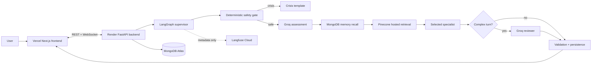
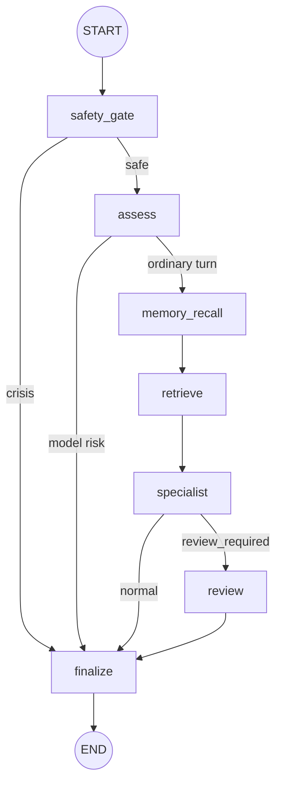

# MindLens V2

> A privacy-conscious hosted LangGraph multi-agent chat system for reflective mental-health support.

MindLens is a portfolio-grade full-stack AI system demonstrating how to build a reliable multi-agent product around a sensitive user experience. It combines a FastAPI API, Next.js chat application, LangGraph orchestration, Groq-hosted models, Pinecone hosted retrieval, MongoDB Atlas persistence, and metadata-only Langfuse observability.

MindLens is not medical advice, diagnosis, therapy, or an emergency service.

**Live frontend:** [mindlens-theta.vercel.app](https://mindlens-theta.vercel.app) · **Source:** [GitHub](https://github.com/AmiruMallawarachchi/mindlens)

The frontend may be unavailable while the backend is sleeping or before cloud credentials are configured. The architecture remains reviewable offline through the diagrams, source, and mocked tests below.

## Why this project is interesting

- Real bounded LangGraph workflow with explicit nodes and conditional edges.
- Deterministic crisis protection before any model call.
- Structured model assessment instead of unconstrained orchestration.
- One selected specialist per ordinary turn, with an optional reviewer.
- Hard maximum of three Groq calls on a normal turn.
- Hosted retrieval over a curated corpus; personal conversations never enter Pinecone.
- PII anonymization before external model calls.
- Langfuse traces exclude prompts, responses, user IDs, and session IDs.
- Stable REST and WebSocket contracts between backend and frontend.
- Graceful degradation when retrieval, tracing, or hosted inference fails.
- Credential-free documentation and tests for recruiter review.

## Architecture



## LangGraph workflow



The graph is deliberately bounded. A deterministic crisis match exits before Groq and Pinecone. An ordinary turn uses assessment plus specialist generation. A complex turn may add one reviewer.

## Repository map

```text
backend/app/agents/hosted_graph.py   LangGraph state, nodes, routing
backend/app/observability.py         Metadata-only Langfuse tracing
backend/app/rag/hosted_retriever.py  Pinecone hosted search adapter
backend/app/routers/chat.py          REST/WebSocket chat entrypoint
backend/tests/unit/agents/            V2 graph contract tests
frontend/src/components/chat/         Chat and pipeline UI
scripts/create_pinecone_index.py      Idempotent index creation
scripts/ingest_pinecone.py            Curated corpus ingestion
docs/ARCHITECTURE.md                  Detailed technical architecture
docs/CODEBASE_MAP.md                  Module-by-module map and request flows
docs/V1_V2_REPORT.md                  Evidence-based V1 post-mortem
docs/RECRUITER_DEMO.md                Offline portfolio walkthrough
docs/V2_HOSTED_DEPLOYMENT.md          Cloud deployment and migration
render.yaml                            Render backend blueprint
```

## Recruiter-friendly review path

A reviewer does not need private credentials to understand the system:

1. Read this README and the diagrams.
2. Read [the architecture document](docs/ARCHITECTURE.md).
3. Follow [the recruiter demo guide](docs/RECRUITER_DEMO.md).
4. Inspect [`hosted_graph.py`](backend/app/agents/hosted_graph.py).
5. Run the mocked graph tests in [`test_hosted_graph.py`](backend/tests/unit/agents/test_hosted_graph.py).

The graph tests mock Groq and Pinecone, so routing, crisis exits, malformed model output, and call limits remain inspectable offline.

## Run locally

```powershell
python -m venv .venv
.\.venv\Scripts\Activate.ps1
python -m pip install -r requirements-dev.txt
Copy-Item backend\.env.example backend\.env
cd backend
uvicorn app.main:app --reload --port 8000
```

In another terminal:

```powershell
cd frontend
npm install
Copy-Item .env.local.example .env.local
npm run dev
```

Open `http://localhost:3000`; the application lives at `/app`. Backend health endpoints are `/health` and `/ready`.

## Tests and quality checks

```powershell
cd backend
python -m pytest tests -q
uv run --no-project ruff check app tests

cd ../frontend
npm run typecheck
npm run lint
npm test
npm run build
```

Backend tests mock every hosted service, so they run offline. Frontend tests
cover the auth gate, the chat frame reducer, the WebSocket message shape, and
journal creation. Neither suite needs credentials.

For the engineering story — what failed in V1, why, and what replaced it — read
[the V1 vs V2 report](docs/V1_V2_REPORT.md). For "where does this code live and
how does a request flow", read [the codebase map](docs/CODEBASE_MAP.md).

## Deployment architecture

| Layer | Service | Responsibility |
|---|---|---|
| Web client | Vercel | Next.js application and chat UI |
| API | Render | FastAPI, WebSocket, LangGraph runtime |
| Generation | Groq | Hosted assessment and response generation |
| Retrieval | Pinecone | Hosted embeddings and corpus search |
| Persistence | MongoDB Atlas | Accounts, sessions, memories, journals, progress |
| Observability | Langfuse Cloud | Allowlisted metadata-only traces |

See [V2 hosted deployment](docs/V2_HOSTED_DEPLOYMENT.md) for secrets, Pinecone setup, Atlas migration, Render, Vercel, CORS, and WebSocket configuration. Free tiers can sleep or impose quotas; those constraints are documented rather than hidden.

## Privacy and safety

- Crisis screening occurs before external model calls.
- Model-detected risk stops specialist generation.
- Conversation text is anonymized before Groq and Pinecone calls.
- Conversations and memories are never indexed in Pinecone.
- Langfuse receives graph/service metadata only.
- Responses are validated before returning to the client.
- Failures produce explicit degraded behavior rather than invented emotional certainty.
- The UI does not display uncalibrated numeric emotion confidence.

## Engineering trade-offs

MindLens uses a small supervisor graph instead of unconstrained agent loops. This improves safety, latency, cost predictability, and debugging. Hosted services replace local model weights, PyTorch, SentenceTransformers, and Chroma in the deployed runtime. The existing product shell and API/WebSocket shapes are preserved to reduce frontend migration risk.

## Status

Implemented: LangGraph runtime, Groq inference, Pinecone adapters and ingestion,
Langfuse tracing, memory extraction, check-in scheduling, Render/Vercel
configuration, Atlas migration runbook, recruiter documentation, V2 graph and
router tests, and frontend component tests.

Deployment state: the Vercel frontend is live, but its current build points at a
local ngrok tunnel that is no longer running, and the Render backend service
defined by `render.yaml` has not been created yet. The application therefore
runs locally but is not reachable end to end in production. Creating the Render
service and rebuilding Vercel with `NEXT_PUBLIC_API_BASE_URL` set to the Render
URL are the remaining steps; see [V2 hosted deployment](docs/V2_HOSTED_DEPLOYMENT.md).

Environment-specific: entering provider credentials, creating the Render
service, migrating private MongoDB data, and creating the Pinecone index and
corpus.

## Responsible use

MindLens is a demonstration of software architecture and responsible AI engineering. It must not substitute for qualified mental-health professionals or emergency services.
