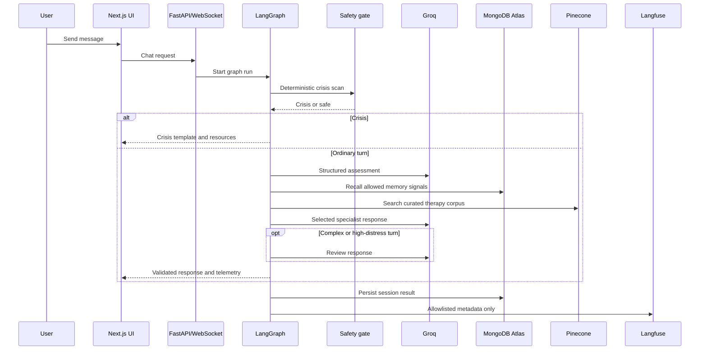
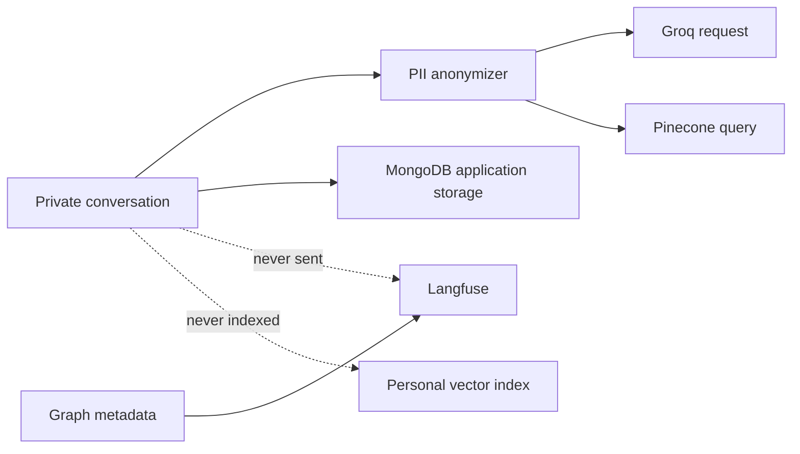

# MindLens V2 Architecture

## Runtime sequence

## State contract

The graph state carries user text only inside the application execution path. External calls receive anonymized text. Important state fields include:

| State | Purpose |
|---|---|
| `safety` | Deterministic and model safety results |
| `assessment` | Structured emotion/context/routing result |
| `eos` | Existing emotional operating state contract |
| `route` | Selected specialist route |
| `rag_chunks` | Curated retrieval context |
| `graph_nodes` | Nodes executed during this turn |
| `llm_calls` | Model, token, and latency metadata only |
| `degraded` | Services or validation that fell back |

## Agent roles

| Node | Type | Responsibility |
|---|---|---|
| `safety_gate` | deterministic | Crisis scan and immediate exit |
| `assess` | Groq structured call | Classify conversational need and route |
| `memory_recall` | application logic | Select non-sensitive memory signals |
| `retrieve` | Pinecone adapter | Search curated therapy knowledge |
| `specialist` | Groq response call | Write the single user-facing draft |
| `review` | optional Groq call | Review complex/high-distress responses |
| `finalize` | deterministic | Crisis template, validation, contract assembly |

This is a multi-agent system because specialized response behavior is selected by route, but it remains supervised and bounded rather than allowing agents to spawn arbitrary work.

## Safety boundaries

1. Regex crisis matches run before Groq and Pinecone.
2. Model-detected risk stops further response generation.
3. Crisis responses use controlled templates and resources.
4. Invalid model JSON falls back to neutral assessment rather than invented certainty.
5. Response validation rejects unsafe or inappropriate output.
6. Pinecone and Langfuse are fail-soft; MongoDB and Groq are required for normal production mode.
7. Langfuse instrumentation is explicit and metadata-only.

## Data boundaries

The Pinecone namespace contains only the curated therapy corpus. Langfuse metadata is limited to graph/node names, route, provider status, model identifier, timing, token usage, and success/fallback status.

## Deployment topology

Render runs the API container. Vercel serves the frontend. The backend has no dependency on local model weights, local Chroma, or durable local files. Render's filesystem is treated as ephemeral, and free-tier cold starts are expected.

## Design decisions

- Hosted models reduce deployment size and eliminate local inference maintenance.
- A bounded graph makes cost and latency observable.
- Stable API/WebSocket contracts avoid a frontend rewrite.
- Deterministic safety logic remains outside probabilistic generation.
- The system exposes degraded states so operators can distinguish a provider outage from an empty answer.
